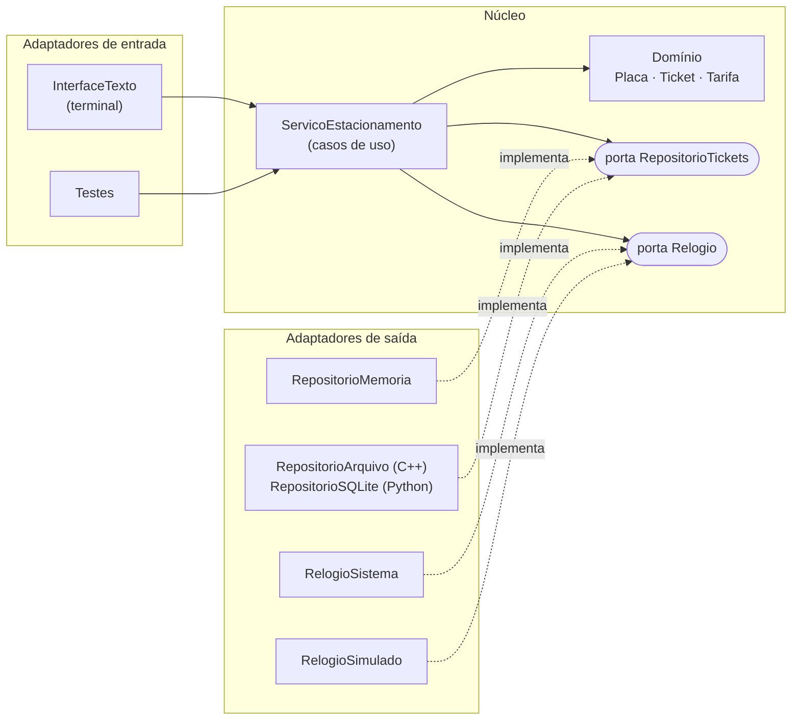

# Estacionamento hexagonal — projeto de referência de POO

Um sistema pequeno e completo para **enxergar uma arquitetura em código real**: o mesmo
estacionamento implementado em **C++17** e em **Python**, com a mesma organização,
os mesmos testes e a mesma saída.

O projeto é material de leitura e experimentação. Não é um exercício para entrega
nem a solução de nenhum trabalho da disciplina.

---

## 1. O problema

Um pátio com vagas limitadas registra entrada e saída de veículos e cobra pela
permanência:

- a placa precisa ser válida (`ABC1234` ou Mercosul `ABC1D23`);
- um veículo não entra duas vezes nem entra com o pátio lotado;
- na saída, a **tarifa** calcula o valor: por padrão, 15 min de tolerância e
  R$ 8,00 por hora iniciada; em dias de evento, um valor fixo de R$ 20,00.

A regra é simples de propósito. O interesse está em **onde cada decisão mora**.

## 2. A ideia em uma figura



- O **núcleo** contém as regras e não conhece terminal, arquivo, banco nem relógio do computador.
- Uma **porta** é uma interface que o núcleo define para dizer do que precisa.
- Um **adaptador** liga uma tecnologia concreta a uma porta.
- A **montagem** (`main.cpp` / `__main__.py`) escolhe os adaptadores e entrega ao núcleo.

As setas de código sempre apontam **para dentro**. O guia
[docs/ARQUITETURA.md](docs/ARQUITETURA.md) explica cada parte, compara com a Clean
Architecture e relaciona o projeto com os padrões Strategy, Adapter e Repository.

## 3. Executar

Requisitos: `g++` com C++17, `make` e Python 3.10 ou superior. Não há dependências externas.

```bash
make test                      # regra de dependência + testes C++ + testes Python + CLIs
make run-cpp                   # terminal interativo em C++ (2 vagas, relógio simulado)
make run-python                # o mesmo em Python
```

Sessão de exemplo ([exemplos/sessao.txt](exemplos/sessao.txt)):

```bash
make build
./build/estacionamento --vagas 2 --relogio simulado < exemplos/sessao.txt
```

Saída esperada (idêntica em Python, com `cd python && python3 -m estacionamento --vagas 2 < ../exemplos/sessao.txt`):

```text
entrada registrada: ABC1D23 às 08:00 (vagas livres: 1)
entrada registrada: XYZ9876 às 08:00 (vagas livres: 0)
erro: pátio lotado
erro: ABC1D23 já está no pátio
relógio: 08:10
saída registrada: XYZ9876 | 10 min | R$ 0,00
relógio: 09:35
saída registrada: ABC1D23 | 95 min | R$ 16,00
erro: não há entrada aberta para ABC1D23
erro: placa inválida: placa-invalida
vagas livres: 2 de 2
ABC1D23 | 08:00 -> 09:35 | 95 min | R$ 16,00
XYZ9876 | 08:00 -> 08:10 | 10 min | R$ 0,00
```

Comandos: `entrada PLACA`, `saida PLACA`, `avancar MINUTOS`, `vagas`, `historico`, `ajuda`, `sair`.

| Opção | Valores | Efeito na montagem |
|---|---|---|
| `--vagas N` | inteiro positivo | capacidade do pátio (padrão 3) |
| `--tarifa` | `hora` ou `fixa` | troca a estratégia de cobrança |
| `--relogio` | `simulado` ou `sistema` | troca o adaptador da porta `Relogio` |
| `--arquivo CAMINHO` (C++) / `--banco CAMINHO` (Python) | caminho | troca o repositório em memória pelo persistente |

O relógio simulado começa às 08:00 a cada execução. Para que o histórico gravado em
arquivo ou banco faça sentido entre execuções, combine a persistência com `--relogio sistema`.
Essa combinação é uma decisão da montagem, não do núcleo.

## 4. Organização

```text
cpp/                                  python/estacionamento/
├── dominio/       regras e valores    ├── dominio/
├── aplicacao/     casos de uso+portas ├── aplicacao/
├── adaptadores/                       ├── adaptadores/
│   ├── entrada/   terminal            │   ├── entrada/
│   └── saida/     repositórios,       │   └── saida/
│                  relógios            │
├── main.cpp       montagem            └── __main__.py   montagem
└── testes/                            python/tests/
tools/verificar_arquitetura.py   falha se o núcleo depender de adaptadores ou de E/S
tools/comparar_cli.py            confere que C++ e Python produzem a mesma saída
```

## 5. Roteiro de leitura sugerido

1. `dominio/tarifa` — Strategy em sua forma mínima.
2. `dominio/placa` e `dominio/ticket` — objetos que protegem as próprias regras.
3. `aplicacao/portas` — o que o núcleo exige do mundo externo.
4. `aplicacao/servico_estacionamento` — os casos de uso coordenando domínio e portas.
5. `adaptadores/saida` — duas implementações para cada porta.
6. `adaptadores/entrada/interface_texto` — tradução entre texto e casos de uso.
7. `main.cpp` / `__main__.py` — o único lugar que conhece tudo.
8. Os testes, na ordem: domínio → serviço → contrato dos repositórios.

## 6. Experimentos

Cada experimento mostra uma consequência da arquitetura. Faça num clone local.

- **Quebrar a regra:** acrescente `#include <iostream>` em `cpp/dominio/ticket.cpp` e
  rode `make arquitetura`. Leia a mensagem e desfaça.
- **Trocar uma estratégia:** crie uma tarifa com teto diário. Quais arquivos mudaram?
  O serviço precisou mudar?
- **Novo adaptador de saída:** escreva um repositório em JSON ou CSV e faça-o passar
  pelos mesmos testes de contrato (`teste_repositorios.cpp` / `test_repositorios.py`).
- **Novo adaptador de entrada:** uma interface Streamlit ou HTTP que use o mesmo
  `ServicoEstacionamento`. Qual código foi reaproveitado sem alteração?

## 7. Limites conhecidos

- O repositório em arquivo regrava tudo a cada operação e não trata dois processos simultâneos.
- Horários são minutos UTC; o terminal mostra apenas `HH:MM`, sem data nem fuso.
- Não há cancelamento de ticket, mensalistas nem pagamento: ficariam como novos casos de uso.
